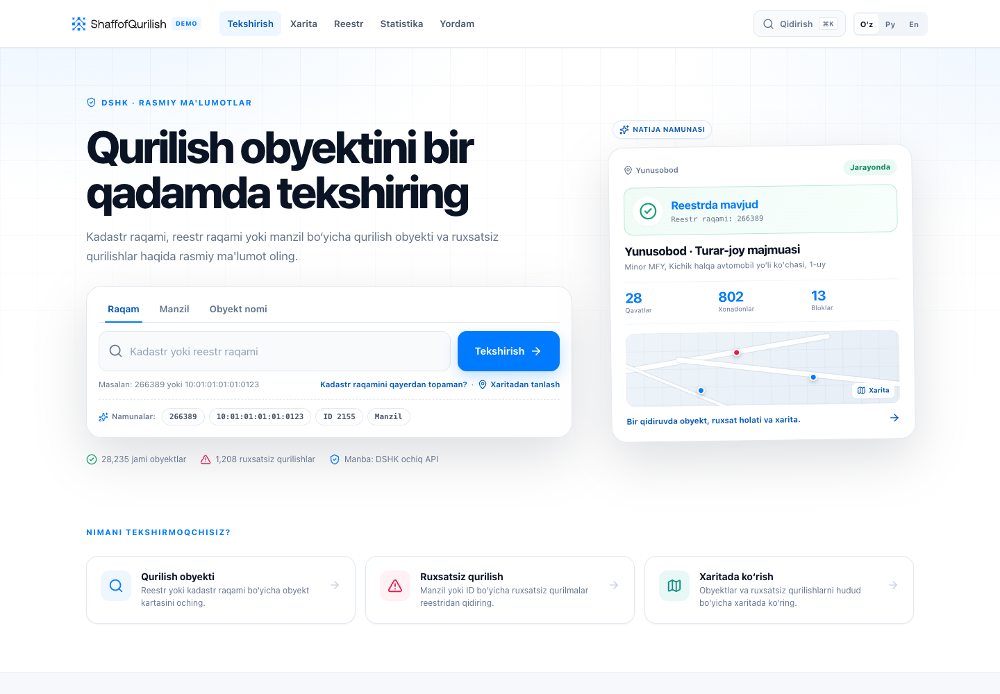
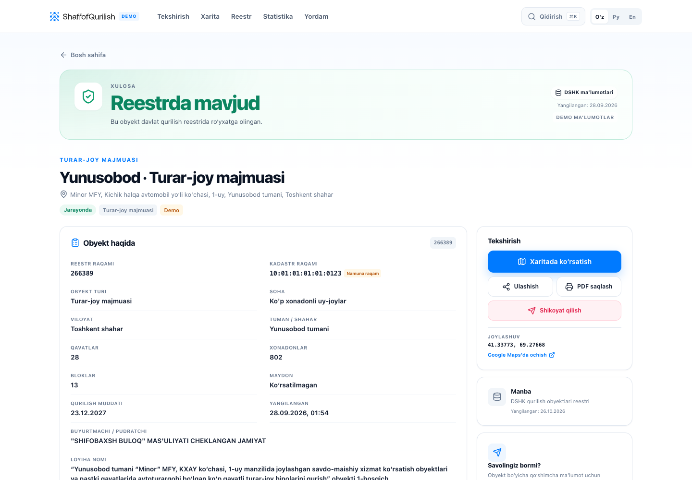
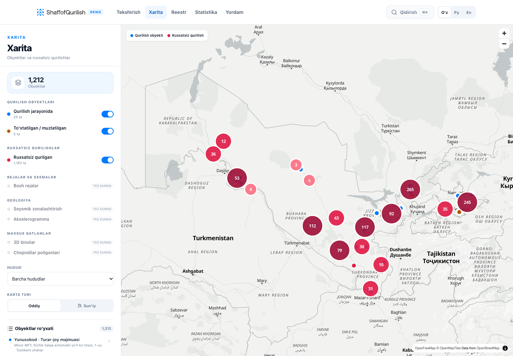

# DSHK redesign — ShaffofQurilish

[](https://react.dev)
[](https://vite.dev)
[](https://maplibre.org)
[](LICENSE)

An unofficial, check-first redesign prototype of Uzbekistan's
[ShaffofQurilish](https://dshk.shaffofqurilish.uz/) portal. A visitor can verify a
construction object by cadastral number, registry number, or address in one step,
then see a plain-language verdict, the source data, and the map location.



## Why this exists

The original portal carries a lot of useful data, but the first screen asks visitors
to learn the site's structure first. This prototype puts the check flow first and
keeps the specialist data one level down: verdict, timeline, blocks, documents, illegal
construction registry, regional statistics, and a map.

## Features

- **One-step check** — cadastral number, registry number, or address.
- **Verdict-first results** — “Reestrda mavjud”, “Ruxsatsiz qurilish”, or “Topilmadi”
  before the detailed facts.
- **Map** — grouped layers, counts, clustering, region filter, object list, satellite
  toggle. MapLibre is lazy-loaded and needs no API key.
- **Registry** — all 1,208 illegal-construction records with search, filters,
  pagination, CSV export, and mobile cards.
- **Statistics** — regional breakdown and CSV export.
- **Help/FAQ** — explains cadastral numbers, appeals, and data sources.
- **Uzbek / Russian / English** with a saved language preference, ⌘K search, and
  print/PDF output.
- **Accessible and responsive** — keyboard-friendly tabs and menus, unique form IDs,
  and layouts from 320 px to 1440 px.

<details>
<summary>More screenshots</summary>

### Result



### Map



</details>

## Run

```bash
npm install
npm run dev       # http://localhost:5173
npm run build     # production build in dist/
npm run preview   # serve the build on http://localhost:4173
```

Hash routing means `dist/` works on any static host without server rewrites.

## Routes

| Route | Purpose |
| --- | --- |
| `#/` | Landing page with search, example chips, and live counts |
| `#/object/construction/:id` | Construction result: verdict, facts, timeline, blocks, documents, photos |
| `#/object/illegal/:id` | Illegal-construction result with decision and act photos |
| `#/map` | Map with grouped layers, clusters, region filter, and object list |
| `#/registry` | Searchable/filterable registry of 1,208 illegal-construction records |
| `#/stats` | Regional statistics and CSV export |
| `#/help` | FAQ and guidance |

Try `266389`, `10:01:01:01:0123` (illustrative cadastral number), or `ID 2155` on the
landing page.

## Data

- `src/data/demo.json` — 30 construction objects from the public DSHK API.
- `src/data/registry.json` — all 1,208 illegal-construction records.
- Cadastral numbers on four demo construction records are illustrative and labelled
  **“Namuna raqam”** in the UI. The rest comes from the API export.
- 26 registry records have no coordinates; the map plots the 1,182 illegal records that
  do, plus the 30 construction objects (1,212 points).
- Search, filtering, pagination, and CSV export run client-side. There is no backend.
- Copy lives in `src/i18n.js`.

Data is a point-in-time export. Wire the prototype to the public API before treating
any value as current.

## Stack

React 19 + Vite 8, MapLibre GL 6, plain CSS under `src/styles/`. The basemap is
OpenFreeMap `positron`; satellite imagery is Esri World Imagery. Both are keyless.
Attribution is rendered in the map.

## Porting notes

- MapLibre is split out of the initial bundle; the map route loads on demand.
- The demo banner in the header and DEMO labels in results are intentional until the
  prototype is connected to live endpoints.
- `src/lib/format.js` formats dates explicitly as `dd.mm.yyyy`; keep that if you add
  locales.
- The design is a prototype, not a production service. It has no authentication,
  audit trail, or write operations.

## Contributing

Issues and pull requests are welcome. Keep changes consistent with the existing
structure, naming, and CSS modules. Run `npm run build` before opening a PR.

## License and attribution

Code is released under the [MIT License](LICENSE).

The ShaffofQurilish name, logo, and datasets come from DSHK and remain the property of
their respective owner. They are included here for demonstration and are **not** covered
by the MIT license. This project is unofficial and is not affiliated with or endorsed by
DSHK.
